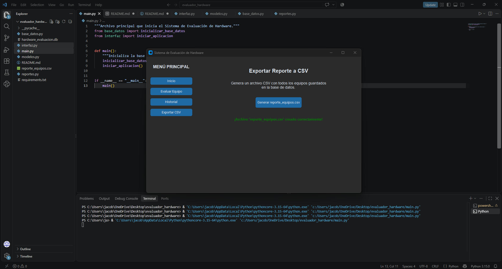

# Sistema de Evaluación de Hardware

Aplicación  para evaluar especificaciones de computadoras, aproximar su precio en pesos dominicanos y guardar los registros en SQLite.

# 1. Problema y justificación
Al comprar o revisar computadoras, muchas veces se evalúan sus componentes sin un criterio unico. Este programa elimina esa necesidad actuando por nosotros automáticamente eVidenciando si un equipo es recomendado o no y dandonos un valor según su memoria RAM y almacenamiento SSD.

# 2. Características principales
- Evaluación  de hardware con conclusion y precio estimado.
- EVita errores por campos Vacios o Valor inValido.
- Almacenamiento base de datos SQLite (`hardware_evaluacion.db`).
- Historial con búsqueda y eliminación por ID.
- Exportación de reportes a archivo CSV (`reporte_equipos.csv`).

# 3. Tecnologías y librerías utilizadas
- Python 3
- CustomTkinter (interfaz gráfica)
- SQLite (`sqlite3`)
- CSV (`csv`)

# 4. Requisitos previos
- Python 3.10 o superior instalado.

# 5. Instalación
1. Abrir la carpeta del proyecto en la terminal.
2. Instalar la librería externa:
   ```bash
   pip install -r requirements.txt
   ```

# 6. Instrucciones de uso
1. Ejecutar el archivo principal:
   ```bash
   python main.py
   ```
2. En el menú lateral izquierdo, entrar a **Evaluar Equipo**, poner los datos (por ejemplo: `Windows 9`, `Ryzen 8`, `16` GB de RAM, `512` GB de SSD) y hacer clic en **Evaluar y Guardar**.

# 7. Estructura del proyecto
- `main.py`: Inicia la base de datos y abre la ventana principal.
- `interfaz.py`: Contiene la interfaz gráfica y las validaciones.
- `modelos.py`: Define la clase `Equipo` y los cálculos.
- `base_datos.py`: Maneja las consultas en SQLite.
- `reportes.py`: Genera el archivo `reporte_equipos.csv`.
- `requirements.txt`: Lista de dependencias del proyecto.

# 8. Capturas de pantalla


# 9. Datos del estudiante
- **Autor:** Shayron Rodriguez
- Curso: Fundamentos de Programación
- Profesor: Daysson Crissauris Bueno
- Institución: Itla